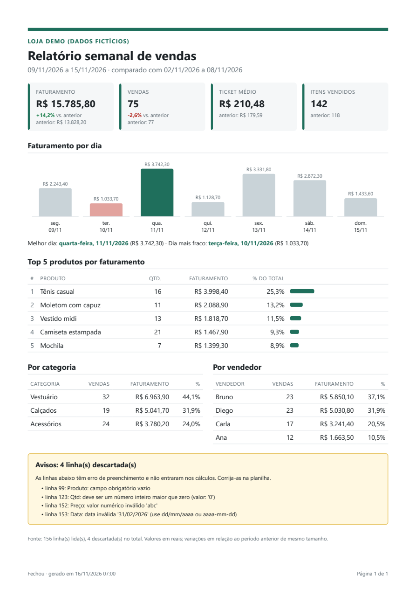

# Fechou

Relatório semanal automático a partir de planilhas: lê CSV ou Google Sheets, calcula os indicadores da semana, gera um PDF e envia por e-mail ou Telegram.

> ✅ **Status: MVP concluído.** Funciona com CSV ou Google Sheets: validação, indicadores, PDF, envio por e-mail (SMTP) com novas tentativas, idempotência, registro das execuções, Docker e agendamento semanal no GitHub Actions. Telegram e `.xlsx` são opcionais e ainda não foram feitos.



*Relatório gerado por `fechou demo` com dados fictícios ([PDF](./docs/exemplo-relatorio.pdf)).*

## Problema

Pequenos negócios registram vendas numa planilha e, toda semana, alguém gasta tempo calculando totais, montando um resumo e enviando ao dono. É repetitivo, sujeito a erro e costuma ser adiado.

## Solução

O Fechou automatiza o ciclo inteiro: **ler → validar → calcular → gerar PDF → entregar → registrar**, em horário agendado e sem intervenção manual.

## Antes e depois

| | Antes (manual) | Depois (Fechou) |
|---|---|---|
| Toda segunda-feira | Abrir a planilha, filtrar a semana, somar, comparar com a anterior, montar o resumo e enviar | O relatório chega por e-mail às 8h |
| Tempo por semana | ~45 min | ~2 min (ler o e-mail) |
| Erros de digitação na planilha | Passam despercebidos e distorcem os totais | Linhas inválidas são descartadas e listadas no relatório |
| Esquecimento ou atraso | Frequente | Agendado; falhas geram alerta no GitHub |

> ⚠️ **Estimativa de demonstração**, não um resultado medido em clientes: cerca de **3 horas por mês** a menos, considerando 45 min por semana de trabalho manual.

## Funcionalidades

- Leitura de CSV (modo demo) e de Google Sheets (conta de serviço, somente leitura)
- Validação por linha, com bloco de avisos no relatório para dados inválidos
- Indicadores: faturamento, nº de vendas, ticket médio, top produtos, por categoria e por vendedor, variação vs. semana anterior
- Relatório em PDF formatado em pt-BR
- Entrega por e-mail (SMTP), com novas tentativas em falhas temporárias
- Execução por linha de comando, em Docker e agendada (GitHub Actions)
- Idempotência: não reenvia o mesmo período, salvo com `--force`
- Modo `demo` que roda sem credenciais e sem enviar nada

## Stack

| Camada | Tecnologia |
|---|---|
| Linguagem | Python 3.12 |
| CLI | Typer |
| Dados | pandas, Pydantic v2 |
| Configuração | YAML (PyYAML) |
| Google Sheets | gspread + google-auth |
| Relatório | Jinja2 + WeasyPrint |
| Persistência | SQLite |
| Qualidade | pytest, ruff, mypy |
| Infra | Docker, GitHub Actions (CI e agendamento) |

## Demonstração em 1 minuto (Docker)

Sem instalar Python nem criar contas. Só é preciso o [Docker](https://docs.docker.com/get-docker/):

```bash
docker compose up --build
```

O que acontece:

1. A imagem do Fechou é construída (Python 3.12, WeasyPrint e fontes já incluídos).
2. Sobe o [Mailpit](https://mailpit.axllent.org/), um servidor de e-mail de teste que **não envia nada para fora**.
3. O Fechou lê o CSV fictício de `examples/`, valida, calcula os indicadores de 09/11/2026 a 15/11/2026, gera o PDF e o envia ao Mailpit.
4. Abra **http://localhost:8025**: o e-mail está lá, com o resumo no corpo e o PDF anexado.

Rode `docker compose up` de novo: como esse período já foi enviado, o Fechou responde "Nada a fazer" (idempotência). Para recomeçar do zero, use `docker compose down -v`. Para só gerar um PDF de demonstração, sem e-mail: `docker compose run --rm fechou demo`.

Para usar a imagem com a sua planilha, monte a configuração, a chave e o volume de dados:

```bash
docker build -t fechou .
docker run --rm --env-file .env \
  -v "$PWD/config.yaml:/app/config.yaml:ro" \
  -v "$PWD/secrets:/app/secrets:ro" \
  -v fechou-data:/app/data \
  fechou run -c config.yaml
```

A imagem roda com um usuário sem privilégios (UID 1000) e não contém segredos: o `.env`, a pasta `secrets/` e o `config.yaml` ficam de fora (`.dockerignore`).

## Desenvolvimento

Requisitos: **Python 3.12** e as bibliotecas do **Pango** (usadas pelo WeasyPrint para gerar o PDF; veja abaixo). As dependências Python ficam no venv do projeto.

```powershell
# Windows (PowerShell)
py -3.12 -m venv .venv
.\.venv\Scripts\python -m pip install "pip-tools>=7.4"
.\.venv\Scripts\pip-sync requirements-dev.txt
.\.venv\Scripts\python -m pip install --no-deps -e .
```

```bash
# Linux/macOS
python3.12 -m venv .venv
.venv/bin/python -m pip install "pip-tools>=7.4"
.venv/bin/pip-sync requirements-dev.txt
.venv/bin/python -m pip install --no-deps -e .
```

### Instalação do WeasyPrint (Pango)

Conforme a [documentação do WeasyPrint](https://doc.courtbouillon.org/weasyprint/stable/first_steps.html):

- **Windows:** instale o [MSYS2](https://www.msys2.org/) com as opções padrão (por exemplo, `winget install MSYS2.MSYS2`). Depois, no shell **MSYS2 UCRT64**, rode `pacman -S mingw-w64-ucrt-x86_64-pango`. Se aparecer `cannot load library ...`, defina `WEASYPRINT_DLL_DIRECTORIES=C:\msys64\ucrt64\bin`.
- **Debian/Ubuntu:** `sudo apt install libpango-1.0-0 libpangoft2-1.0-0 libharfbuzz0b libharfbuzz-subset0 fonts-dejavu-core`.
- Para conferir: `python -m weasyprint --info`.

Sem o Pango, `fechou validate` continua funcionando; só a geração do PDF falha, com uma mensagem explicando o motivo. Os testes de PDF são pulados localmente e obrigatórios no CI.

Checagens (as mesmas que rodam no CI):

```bash
ruff check .
ruff format --check .
mypy
pytest
```

### Dependências

As dependências são declaradas no `pyproject.toml` e fixadas com **pip-tools** em `requirements.txt` (execução) e `requirements-dev.txt` (desenvolvimento). Ao alterar dependências:

```bash
pip-compile --strip-extras -o requirements.txt pyproject.toml
pip-compile --strip-extras --extra dev -o requirements-dev.txt pyproject.toml
pip-sync requirements-dev.txt && pip install --no-deps -e .
```

Detalhes em [`docs/decisions/0001-dependency-locking-with-pip-tools.md`](./docs/decisions/0001-dependency-locking-with-pip-tools.md).

## Como usar

### Comandos

```text
fechou --version
fechou init-config [--output config.yaml] [--overwrite]
fechou validate --config config.yaml
fechou demo [--output ./out]
fechou run --config config.yaml [--start AAAA-MM-DD --end AAAA-MM-DD] [--dry-run] [--force] [--output ./out]
```

Primeiros passos com o CSV de demonstração:

```bash
fechou init-config                 # cria config.yaml comentado
cp .env.example .env               # preencha SMTP_* (veja "Envio por e-mail")
fechou validate -c config.yaml     # confere a planilha
fechou run -c config.yaml --start 2026-11-09 --end 2026-11-15 --dry-run   # gera o PDF sem enviar
fechou run -c config.yaml --start 2026-11-09 --end 2026-11-15             # envia
```

**`fechou demo`** gera dados fictícios da semana passada e da anterior (com 4 linhas inválidas de propósito), passa pelo mesmo fluxo de uma execução real (CSV → validação → indicadores → PDF), salva o CSV e o PDF em `./out` e imprime o resumo. **Nada é enviado.**

```text
Relatório semanal de vendas — Loja Demo (dados fictícios)
Período: 09/11/2026 a 15/11/2026

• Faturamento: R$ 15.785,80 (+14,2% vs. período anterior)
• Vendas: 75 (-2,6% vs. período anterior)
• Ticket médio: R$ 210,48
• Itens vendidos: 142
• Produto destaque: Tênis casual (R$ 3.998,40)
• Melhor dia: quarta-feira, 11/11/2026 (R$ 3.742,30)
• Dia mais fraco: terça-feira, 10/11/2026 (R$ 1.033,70)

Atenção: 4 linha(s) descartada(s) por erro de preenchimento.
```

O `validate` lê a planilha, aplica as regras de validação e lista as linhas descartadas com o motivo, sem gerar nem enviar nada. Ele sai com código `0` quando tudo é válido e `1` quando há linhas inválidas ou erro de configuração. Exemplo com o CSV de demonstração, que tem 6 linhas quebradas de propósito:

```text
Fonte: loja-demo (csv)
Linhas lidas: 785
Válidas: 779
Inválidas: 6

Linhas com problema (serão descartadas do relatório):
  - linha 15: Produto: campo obrigatório vazio
  - linha 27: Qtd: deve ser um número inteiro maior que zero (valor: '0')
  - linha 111: Preço: valor numérico inválido 'abc'
  ...
```

### `fechou run`

Executa o fluxo completo: **período → já enviado? → ler → validar → calcular → PDF → enviar → registrar**.

- **Período padrão:** a semana passada (segunda a domingo, no fuso do relatório). Com `--start` e `--end` (sempre juntos), qualquer intervalo.
- **Idempotência:** se o relatório daquela fonte e período já foi enviado, o comando encerra com "Nada a fazer" (código 0) **sem ler a planilha**. `--force` reenvia.
- **`--dry-run`:** faz tudo, exceto enviar. Mostra o resumo e salva o PDF. Não precisa de SMTP configurado e não conta como enviado.
- **Falhas de rede:** até 3 novas tentativas (esperas de 2 s, 4 s e 8 s). Erros definitivos, como senha errada ou destinatário recusado, não são repetidos.
- **Período sem vendas:** com `empty_period_policy: send_empty`, envia um relatório "Sem movimento"; com `skip`, só registra.
- O PDF de cada execução fica salvo em `OUTPUT_DIR` (padrão `./out`).

| Código de saída | Significado |
|---|---|
| `0` | Enviado, simulação concluída ou nada a fazer |
| `1` | Erro de configuração ou de dados (nada foi enviado) |
| `2` | Falha na entrega depois das novas tentativas |

Cada execução é gravada na tabela `runs` do SQLite (`DATABASE_PATH`, padrão `./data/fechou.db`), com período, status, contagem de linhas, destinatários e erro. Os logs saem em JSON no stderr, com um `run_id` por execução, e trazem só contagens e status, nunca linhas da planilha nem e-mails.

### Envio por e-mail

Funciona com qualquer servidor SMTP. Configure no `.env` (modelo em [`.env.example`](./.env.example)):

| Variável | Exemplo | Observação |
|---|---|---|
| `SMTP_HOST` / `SMTP_PORT` | `smtp.gmail.com` / `587` | |
| `SMTP_SECURITY` | `starttls` | `starttls` (587), `ssl` (465) ou `none` (só para servidor de teste local) |
| `SMTP_USER` / `SMTP_PASSWORD` | | No Gmail, use uma **senha de app**, nunca a senha da conta |
| `SMTP_FROM` | `Fechou <relatorios@exemplo.com>` | Remetente |

Os destinatários e o assunto ficam no `config.yaml` (`delivery.email`). O assunto aceita `{start}`, `{end}` e `{business}`.

Para testar sem enviar e-mails de verdade, aponte para um servidor SMTP de testes local (por exemplo, o Mailpit) com `SMTP_SECURITY=none`. Um `docker-compose` com Mailpit está planejado para a Fase 6.

### Ler do Google Sheets

O Fechou lê a planilha com uma **conta de serviço** do Google: um "usuário robô" com e-mail próprio, que só enxerga as planilhas compartilhadas com ele. O acesso é **somente leitura**. Faça isto uma vez:

1. **Projeto e API.** No [Google Cloud Console](https://console.cloud.google.com/), crie (ou escolha) um projeto. Em **APIs e serviços > Biblioteca**, ative a **Google Sheets API**. A Google Drive API **não** é necessária, porque o Fechou abre a planilha pelo ID.
2. **Conta de serviço.** Em **IAM e administrador > Contas de serviço**, clique em **Criar conta de serviço**. Basta um nome (ex.: `fechou`); ela não precisa de nenhum papel no projeto.
3. **Chave JSON.** Abra a conta criada, vá na aba **Chaves**, clique em **Adicionar chave > Criar nova chave**, escolha **JSON** e clique em **Criar**. O arquivo é baixado **uma única vez**.
4. **Guarde a chave fora do Git.** Salve como `secrets/service-account.json` (a pasta `secrets/` está no `.gitignore`) e aponte no `.env`:
   ```dotenv
   GOOGLE_APPLICATION_CREDENTIALS=./secrets/service-account.json
   ```
5. **Compartilhe a planilha.** Copie o `client_email` do JSON (algo como `fechou@seu-projeto.iam.gserviceaccount.com`). Na planilha, clique em **Compartilhar**, cole esse e-mail e dê permissão de **Leitor**. Sem isso a leitura falha.
6. **Configure a fonte** no `config.yaml`:
   ```yaml
   source:
     id: minha-loja
     type: google_sheets
     spreadsheet_id: "https://docs.google.com/spreadsheets/d/1AbC...xyz/edit"   # URL ou só o ID
     worksheet: "Vendas"     # nome exato da aba
     # range: "A1:F"         # opcional; a 1ª linha do intervalo é o cabeçalho
   ```
7. **Teste:** `fechou validate -c config.yaml`. A saída mostra `Fonte: minha-loja (google_sheets)` e as linhas com problema.

Como a planilha é lida:

- As células são lidas **sem formatação**, então o resultado não depende do idioma da planilha. Uma data mostrada como `05/11/2026` (pt-BR) ou `11/5/2026` (en-US) vira o mesmo dia. Valores numéricos vêm como números, e células digitadas como texto passam pelas mesmas regras do CSV (tabela abaixo).
- Linhas em branco no topo são ignoradas: o cabeçalho é a primeira linha preenchida. Os avisos citam o número real da linha na planilha.
- Erros temporários do Google (limite de requisições, indisponibilidade) geram até 3 novas tentativas, com esperas de 2 s, 4 s e 8 s.

Problemas comuns:

| Mensagem | O que fazer |
|---|---|
| `... não tem acesso à planilha` | Compartilhe a planilha com o `client_email` da chave (Leitor) |
| `Planilha '...' não encontrada` | Confira o `spreadsheet_id` (o trecho entre `/d/` e `/edit` na URL) e o compartilhamento |
| `Aba '...' não encontrada` | Use o nome exato da aba; a mensagem lista as abas existentes |
| `A Google Sheets API não está ativada` | Ative a API no mesmo projeto da conta de serviço (passo 1) |
| `O Google recusou a chave` | A chave foi revogada ou o relógio do computador está errado. Gere uma nova chave |
| Não aparece a opção de criar chave | Organizações do Google Workspace criadas desde maio de 2024 bloqueiam chaves por padrão (política `iam.disableServiceAccountKeyCreation`). Peça uma exceção ao administrador ou use uma conta Google pessoal |

### Agendamento no GitHub Actions

O workflow [`.github/workflows/weekly-report.yml`](./.github/workflows/weekly-report.yml) roda **toda segunda-feira às 8h (horário de Brasília)** e envia o relatório da semana anterior (segunda a domingo). Não é preciso servidor.

**Horário e fuso.** O cron do GitHub Actions usa UTC por padrão. O workflow usa a opção `timezone: America/Sao_Paulo`, aceita hoje pelo GitHub, então o horário já fica em Brasília:

| Horário desejado (Brasília, UTC-3) | `cron` com `timezone: America/Sao_Paulo` | Equivalente em UTC (sem `timezone`) |
|---|---|---|
| Segunda, 08:00 | `0 8 * * 1` | `0 11 * * 1` |
| Segunda, 07:30 | `30 7 * * 1` | `30 10 * * 1` |
| Sexta, 18:00 | `0 18 * * 5` | `0 21 * * 5` |

Como o Brasil não tem horário de verão desde 2019, a diferença é sempre de 3 horas. Se o horário de verão voltar, a opção `timezone` acompanha a mudança; um cron em UTC, não.

**Como ativar** (em *Settings > Secrets and variables > Actions* do repositório):

1. Em **Variables**, crie `FECHOU_ENABLED` = `true`. Sem ela, o workflow não faz nada, o que evita falhas em forks e no repositório de portfólio.
2. Em **Secrets**, crie:

   | Secret | Conteúdo |
   |---|---|
   | `FECHOU_CONFIG` | O conteúdo inteiro do seu `config.yaml` (use a fonte `google_sheets`) |
   | `GOOGLE_SERVICE_ACCOUNT_JSON` | O conteúdo inteiro da chave JSON da conta de serviço |
   | `SMTP_HOST`, `SMTP_PORT`, `SMTP_SECURITY`, `SMTP_USER`, `SMTP_PASSWORD`, `SMTP_FROM` | Como no `.env` (veja "Envio por e-mail") |

3. Teste em *Actions > Weekly report > Run workflow*, marcando **Simular** (`--dry-run`). O mesmo botão aceita período (`start`/`end`) e **Reenviar** (`--force`).

Bom saber:

- Se a execução falhar (código 1 ou 2), o job fica vermelho e o GitHub avisa por e-mail quem configurou o workflow.
- O GitHub pode **atrasar** execuções agendadas em horários de pico e, com carga muito alta, até descartá-las. Se a pontualidade for crítica, use outro agendador.
- Em repositórios **públicos**, o GitHub desativa workflows agendados após **60 dias sem atividade** no repositório.
- O histórico de execuções (SQLite) é guardado no cache do Actions entre uma execução e outra. Isso evita reenviar a mesma semana quando alguém roda o workflow de novo, mas o cache é **melhor esforço**: o GitHub apaga caches sem uso há 7 dias. Se o histórico se perder, a semana seguinte é enviada normalmente; só um reenvio manual da mesma semana deixaria de ser bloqueado. Duas execuções nunca rodam ao mesmo tempo (`concurrency`).

**Outras formas de agendar.** Em um servidor ou computador sempre ligado, use o cron do sistema (`0 8 * * 1 cd /caminho/fechou && .venv/bin/fechou run -c config.yaml`, no fuso do servidor) ou o Agendador de Tarefas do Windows. O código de saída (`0`, `1` ou `2`) indica o resultado.

### Configuração

Gere um modelo com `fechou init-config` ou copie [`examples/config.example.yaml`](./examples/config.example.yaml) e ajuste. Caminhos relativos são resolvidos a partir da pasta do arquivo de configuração. A seção `columns` liga os nomes internos (`date`, `product`, `category`, `quantity`, `unit_price`, `seller`) aos nomes das colunas da sua planilha. `category` e `seller` são opcionais.

Formatos aceitos nas células:

| Campo | Aceita | Rejeita |
|---|---|---|
| Data | `12/11/2026`, `2026-11-12` | `31/02/2026`, `12-11-2026` |
| Quantidade | inteiro > 0 | `0`, `-1`, `2,5` |
| Preço | `49,90`, `49.90`, `R$ 1.234,56`, `1,234.56` | negativos, texto, mais de 2 casas (`1.234` é ambíguo) |

No Google Sheets, células formatadas como data ou número dispensam essas regras (veja acima); elas valem para células digitadas como texto.

### Dados de demonstração

O arquivo `examples/vendas_demo.csv` é **fictício** e reprodutível (semente fixa). Para regenerá-lo:

```bash
python scripts/generate_demo_data.py [--start 2026-09-07] [--end 2026-11-15] [--seed 42] [--invalid 6]
```

O PDF de exemplo em `docs/` (data fixa, 16/11/2026) é regenerado com `python scripts/generate_sample_report.py`.

### Período e indicadores

- **Período padrão:** a última semana completa (segunda a domingo) no fuso do relatório (`America/Sao_Paulo` por padrão). Ela é comparada com a semana imediatamente anterior. Com `--start/--end` no `fechou run`, a comparação é com o mesmo número de dias imediatamente antes.
- **Indicadores:** faturamento, número de vendas, itens vendidos, ticket médio, top 5 produtos, faturamento por categoria e por vendedor, faturamento por dia, melhor e pior dia, e variação de faturamento e de vendas em relação ao período anterior ("—" quando o anterior é zero).
- Valores monetários são calculados sem `float` (centavos inteiros). As regras de arredondamento e desempate estão em [`docs/decisions/0004-period-and-metrics-rules.md`](./docs/decisions/0004-period-and-metrics-rules.md).

### Ainda não implementado (opcionais)

- Entrega por Telegram. Hoje, `delivery.telegram.enabled: true` gera um erro claro de "ainda não disponível".
- Leitura de `.xlsx`.
- Alerta de falha por Telegram. Por enquanto, o aviso de falha vem do próprio agendador (job vermelho no GitHub Actions).

## Roadmap

- [x] Fase 0: estrutura do projeto, lint, testes e CI
- [x] Fase 1: modelos, leitura de CSV, validação e dados de demonstração
- [x] Fase 2: cálculo de período e indicadores
- [x] Fase 3: relatório em PDF e comando `demo`
- [x] Fase 4: entrega por e-mail, idempotência e registro de execuções
- [x] Fase 5: integração com Google Sheets
- [x] Fase 6: Docker, agendamento e documentação final
- [ ] GIF de demonstração de 30 a 60 s (roteiro em [`docs/portfolio.md`](./docs/portfolio.md))
- [ ] Opcional: Telegram, `.xlsx` e alerta de falha

## Limitações

- Sem interface web nem múltiplos usuários.
- Duas execuções **simultâneas** do mesmo período podem enviar em dobro. Com um único agendador isso não ocorre (veja a decisão 0006).
- Lê uma aba por configuração; para várias lojas, use um `config.yaml` (com `id` próprio) para cada.
- No GitHub Actions, o histórico de execuções depende do cache (veja "Agendamento no GitHub Actions").
- Os números de "Antes e depois" são **estimativas de demonstração**, não resultados medidos em clientes.

## Decisões técnicas

Registradas em [`docs/decisions/`](./docs/decisions/).

## Licença

[MIT](./LICENSE).
